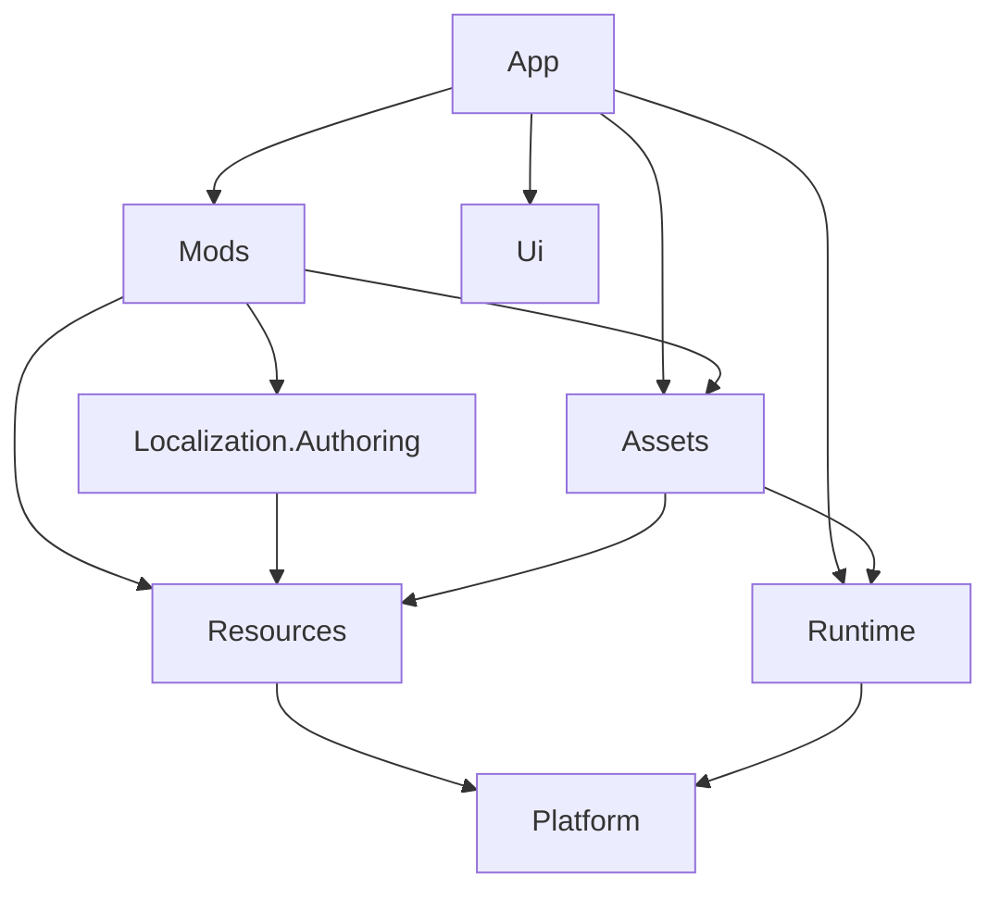

# Localization authoring contracts

The [translator-focused audit](localization-workbench-audit.md) follows canonical identities through each renderer family and records bounded integration findings.

`Memoria.FF8.Localization.Authoring` references Resources only. It supplies row/Target snapshots, asynchronous storage contracts, the edit/preview/conflict session, draft undo/redo, immutable saved-change records, selective replay proposals, search and separately persisted user authoring state. GPU objects, window handles, installed-game paths and filesystem-provider implementations do not enter this assembly.

## Dependency and ownership audit

The declared project-reference spine is acyclic. Arrows below mean a project reference; unrelated product/vendor references are omitted.

The checkable reference audit starts at [Authoring.csproj](../../src/Memoria.FF8.Localization.Authoring/Memoria.FF8.Localization.Authoring.csproj): its sole project reference is Resources. Continue through [Resources.csproj](../../src/Memoria.FF8.Resources/Memoria.FF8.Resources.csproj), [Mods.csproj](../../src/Memoria.FF8.Mods/Memoria.FF8.Mods.csproj), [Assets.csproj](../../src/Memoria.FF8.Assets/Memoria.FF8.Assets.csproj), [Runtime.csproj](../../src/Memoria.FF8.Runtime/Memoria.FF8.Runtime.csproj), [Ui.csproj](../../src/Memoria.FF8.Ui/Memoria.FF8.Ui.csproj) and [App.csproj](../../src/Memoria.FF8.App/Memoria.FF8.App.csproj). Resources has no reference back to Authoring/Mods/App; Ui has no project references. Desktop composition and native parser/file-provider adapters therefore do not create a reverse dependency into the portable authoring core.

| Layer | Owns | Boundary |
| --- | --- | --- |
| Resources | Canonical bindings/fragments, source roles, immutable localization catalogs and portable font/codec models. | Data/selection contracts; no desktop control or persistence adapter. |
| Localization.Authoring | Drafts, conflicts, semantic replay, journals/search and user-state models. | Asynchronous store and syntax interfaces; Resources-only dependency. |
| Mods/Assets | Current JSON/XLSX providers, transactions/recovery, canonical source preparation, resource binding checks and the native prefix adapter. | Reuses the existing parsers/compiler rather than introducing a second text/coordinate store. |
| Ui | Generic editor state, Unicode editing and UI primitives. | No mod/resource project dependency. |
| App | Workbench controller, selected-project overlay, safe context capture, render/pick geometry, input/IME and publication scheduling. | Connects portable contracts to the active game and presentation generation. |
| Runtime | Native gameplay-owned message state and transient world observation evidence. | Presentation occurrence evidence does not enter native record equality or saved JSON. |

The [player workbench guide](../players/localization-workbench.md) explains editing and captured-context preview; [language-role/file contracts](../modding/localization.md) define Source Scripts/Source Reference/Target and absence states. [Font and encoding profiles](../modding/encoding-profiles.md) documents independent profile namespaces, resource/field/dictionary context and portable dependency closures. Rendering and retained control ownership are described in the [UI framework guide](ui-framework.md).

## Storage and context contracts

`LocalizationProjectStore` in Mods owns JSON/XLSX persistence. `FieldMessageTargetSyntax` delegates grammar validation to `FieldMessageContext`; its transient spans preserve untouched prefix components and the body. The overload accepting `nativeBase` seeds an absent Target with designated source prose and verified base WH/choice blocks. Reference presentation is never imported as native layout merely because its prose was selected.

Read a row with `ReadRowAsync`. For a bound resource missing from an older project, supply its verified canonical catalog record to `ReadOrPrepareRowAsync`; do not generate a key from rendered text. Preparation validates the candidate inventory and writes nothing. Commit inserts into the matching payload, creates a missing split payload with its manifest declaration, or adds a declared worksheet to an existing workbook. Worksheet naming avoids collisions with translator annotation sheets. Manifest, payload and native sidecar changes share the recovery transaction; existing workbook parts and unrelated payload bytes are preserved.

Use `LocalizationProjectBuilder.CreateVerifiedRecord` to retain the source catalog's structured native metadata without reproducing its serialization in the host. `LocalizationRuntime.PrepareAuthoringProject` validates the selected package and required base chain through the ordinary runtime compiler, then filters the compiled output to the selected package's text/artwork contributions. The original catalog's enabled state and saved order remain unchanged.

The snapshot revision is a portable SHA-256 of canonicalized manifest/row evidence and declared encoding dependencies. Dictionary/JSON property ordering and workbook formatting do not change that evidence. References, binding metadata, Target absence/null/empty and project role/dependency changes do. Commit requires the exact immutable snapshot that the translator reviewed. Conflict resolution saves the exact selected candidate against immutable Theirs evidence; a second external edit triggers another review.

The provider validates candidate rows and parses patched payload bytes before publication. Existing saves touch one payload. Missing-row insertion also updates the native metadata sidecar. Both use short per-package cross-process coordination, final content rechecks, flushed adjacent staging/backups and an on-disk recovery journal. Normal readers acquire that coordination and roll back an interrupted journal before returning a project. Publication of a complete candidate removes the journal; a crash before that point restores the original files on the next read. The last committed package remains authoritative if staging is interrupted.

This protocol coordinates Memoria writers and detects ordinary external edits/locks. Atomic replacement is not compare-and-swap against an arbitrary uncooperative external rename. The provider reports busy/retry outcomes and does not promise simultaneous editing safety. Runtime publication remains a separate host responsibility: a durable Saved result must not be confused with acceptance by the current live generation.

`LocalizationReplay.Propose` applies only a record's semantic ownership mask onto the current Target. Body, XY, WH, choices and absence are independent. Retained prefix components require a body, so undoing a translation under a later XY edit materializes the designated source body. `ReviewReplayAsync` captures Current and Proposed; `ApplyReplayAsync` commits that reviewed revision without adding recursive replay records. Clearing dialogue observations does not clear saved Changes.

Persist recoverable drafts through `LocalizationAuthoringState.SaveAsync` at a user-state path supplied by the host. It atomically replaces the state document, preserves Base identity/revision and caret/selection, and keeps drafts/journals out of localization packages. Schedule this work outside the input/render thread, rather than synchronously on every keystroke.

Focused storage coverage lives in `LocalizationAuthoringStoreTests`: unrelated-row rebasing, same-row reference conflicts, unknown JSON preservation, retained ancillary workbook parts, busy/cancel/no-op handling, source-role migration, prefix fidelity, independent replay, missing-row insertion and interrupted-transaction recovery. These checks do not require original game assets or battle-effect tests.

`RecreateGame.LocalizationAuthoring.Preview` snapshots names/message variables, retains native dictionary context and uses the production parser/layout for detached preview. Missing captured formatting arguments produce a diagnostic rather than replaying gameplay or substituting live values. `LocalizationCatalog.WithOverlay` retains layer priority, and `WithoutContribution` resolves a proposed row removal without erasing other rows from the selected package. Alias resolution returns the actual winning key/contributor; contributor identity participates in publication evidence even when wording is unchanged.

System composite validation uses the BCL `CompositeFormat` parser and a bounded span-formatting probe. The authoritative authored source determines required argument IDs/counts and format components independently of edited Source metadata or SourcePresent. Native-control-owned System strings retain their separate control contract. All 20 new composite-format cases pass; see [verification status](localization-workbench-audit.md#closure-status-at-the-integration-checkpoint).

Cached Classic and Remastered FL resources return independent per-open byte snapshots under a source gate. The gate covers lookup/cache mutation, complete entry reads and disposal; Classic prefix reads keep their bounded streaming path through nested archive disposal. A caller cannot retain a vendor entry stream over the source's shared seek cursor. Snapshots are not retained in the resource catalog, and no game-specific font/dictionary serialization workaround is required.

Installed native-font creation intersects declared metric indices with complete atlas rectangles while retaining native column placement and strict unsupported-glyph diagnostics. Layout distinguishes pen advance, painted extents and newline leading. Shared menu allocations use the selected font's measured extents and preserve fractional transformed widths and glyph scale. The final installed System/Native authoring workflows and inspected Native output pass; see the [final delivery status and remaining acceptance limits](localization-workbench-audit.md#final-delivery-status). Automatic Japanese atlas import, original-game native deployment, live desktop IME/Excel coexistence, other desktop runtime acceptance and the final post-font package rerun are not implied by these checks.
